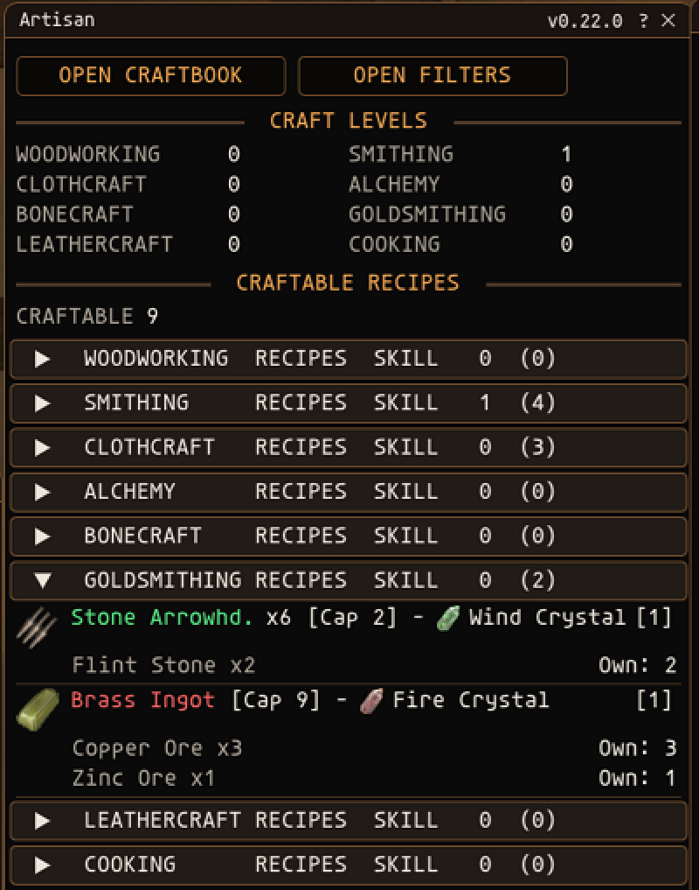
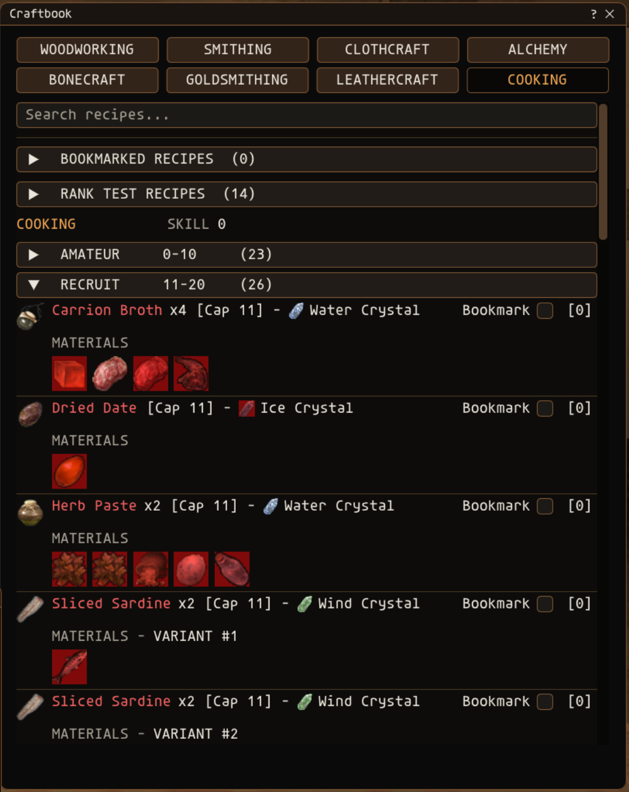
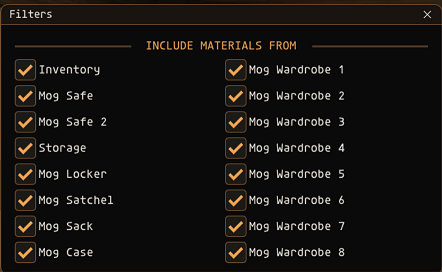
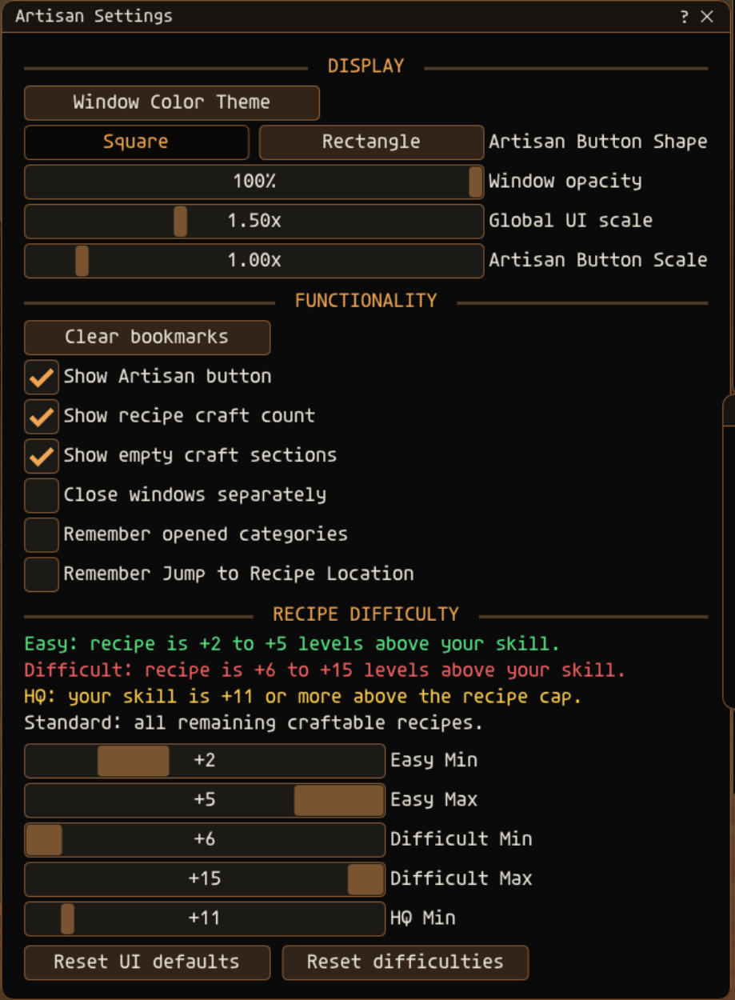

<h1 align="center">Artisan</h1>

<p align="center"><strong>Know what you can make with the materials you already have.</strong></p>

<p align="center">
  A Final Fantasy XI crafting companion built for Phoenix.<br>
  Browse the server's recipes, check your available materials, and find your next craft in one place.
</p>

---

<h2 align="center">Craftable Recipes at a Glance</h2>

<table align="center" border="0">
  <tr>
    <td align="left">
      <ul>
        <li>Scan recipe availability across all eight crafts in one compact window.</li>
        <li>Match requirements against your craft skills, key items, and selected storage.</li>
        <li>Expand each craft to review ingredients, owned counts, and missing materials.</li>
        <li>See how many times each available recipe can be crafted.</li>
      </ul>
    </td>
  </tr>
</table>

<p align="center">
  
</p>

<h2 align="center">A Comprehensive Craftbook</h2>

<table align="center" border="0">
  <tr>
    <td align="left">
      <ul>
        <li>Browse recipes across all eight crafts, organized by guild rank.</li>
        <li>See skill caps, crystals, ingredients, and yields.</li>
        <li>Review key items, subcrafts, variants, and rank tests.</li>
        <li>Search the collection or bookmark recipes for quick access.</li>
      </ul>
    </td>
  </tr>
</table>

<p align="center">
  
</p>

<h2 align="center">Choose Which Storage Counts</h2>

<table align="center" border="0">
  <tr>
    <td align="left">
      <ul>
        <li>Select material sources individually.</li>
        <li>Count items across supported bags, safes, storage, and wardrobes.</li>
        <li>Keep craftable recipes matched to the locations you choose.</li>
        <li>Save your filter choices between sessions.</li>
      </ul>
    </td>
  </tr>
</table>

<p align="center">
  
</p>

<h2 align="center">Make Artisan Yours</h2>

<table align="center" border="0">
  <tr>
    <td align="left">
      <ul>
        <li>Customize window, font, and accent colors.</li>
        <li>Adjust opacity and scale the interface or launcher independently.</li>
        <li>Choose the launcher shape, visibility, and window behavior.</li>
        <li>Set visual difficulty colors by the gap between skill and recipe cap.</li>
      </ul>
    </td>
  </tr>
</table>

<p align="center">
  
</p>

## Install

1. Copy the entire `Artisan` folder into your Ashita `addons` folder:

   ```text
   <Ashita>\addons\Artisan\
   ```

2. In game, load it:

   ```text
   /addon load Artisan
   ```

3. To load it automatically, add this line to your Ashita startup script, often `scripts\default.txt`:

   ```text
   /addon load Artisan
   ```

## Settings

Type `/artisan` while the main window is open to open Settings. If the main window is hidden, the same command restores it.

The settings window provides:

- Window, font, and accent colors
- Window opacity
- Global UI scale from 0.75x to 3.00x
- Independent launcher-button scale, shape, and visibility
- Recipe craft-count and empty-section visibility
- Independent closing behavior for secondary windows
- Optional memory for opened categories and Jump to Recipe highlighting
- Easy, Difficult, and HQ recipe-color thresholds
- Bookmark and display reset controls

Use **Open Filters** in the main window to select which bags and wardrobes contribute to material counts.

## Additional commands

| Command | Action |
| --- | --- |
| `/artisan settings` | Open the settings window |
| `/artisan book` or `/artisan craftbook` | Open the Craftbook |
| `/artisan toggle` | Toggle the main window |
| `/artisan show` | Show the main window |
| `/artisan hide` | Hide the main window |
| `/artisan lock` | Lock the main window in place |
| `/artisan unlock` | Unlock main-window movement |
| `/artisan refresh` | Refresh cached inventory counts |
| `/artisan scale 1.25` | Set global UI scale from 0.75 to 3.00 |
| `/artisan ranges 2 5 6` | Set the Easy and Difficult color ranges |
| `/artisan yellow 11` | Set the skill gap used for the yellow HQ-range color |

## How recipe matching works

- Material counts are read from the storage locations enabled in **Open Filters**.
- A recipe requires one crystal and the full listed quantity of every ingredient.
- Recipes requiring a crafting key item are excluded when that key item is not owned.
- The primary craft and every subcraft must be within the 15-level synthesis-attempt limit.
- The bracketed number at the end of a recipe is the number of times it can be crafted with the available materials.
- Green, red, yellow, and white recipe names indicate the configured difficulty ranges; these colors do not change craftability.
- Right-clicking an item lists recipes that produce it. Selecting one opens its craft and rank section, centers the recipe, and outlines it.
- Equal-level cross-craft recipes appear in every applicable Craftbook.

## Recipe data

The generated recipe files under `data/` are derived from the public [Phoenix project](https://github.com/phoenixffxi/Phoenix) at commit [`6976f063d36f9e5b17072df4922c2ae0c13c024a`](https://github.com/phoenixffxi/Phoenix/tree/6976f063d36f9e5b17072df4922c2ae0c13c024a). The upstream recipe source is licensed under the GNU General Public License v3.0.

The recipe books are stored as native Lua, so Artisan has no runtime network or SQL dependency. See [docs/recipe-data.md](docs/recipe-data.md) for the exact source file, checksum, filtering rules, craft counts, and regeneration instructions. See [THIRD_PARTY_NOTICES.md](THIRD_PARTY_NOTICES.md) for complete attribution.

## Uninstall

Run `/addon unload Artisan`, then remove the `addons\Artisan` folder. Saved settings are stored by Ashita under `config\addons\Artisan`.

## Safety and scope

Artisan is read-only. It does not synthesize items, move inventory, send packets, or modify game memory.

## License and attribution

Artisan's original source code is licensed under the MIT License. See [LICENSE](LICENSE) for details. Generated recipe data retains its upstream attribution and license notice.
